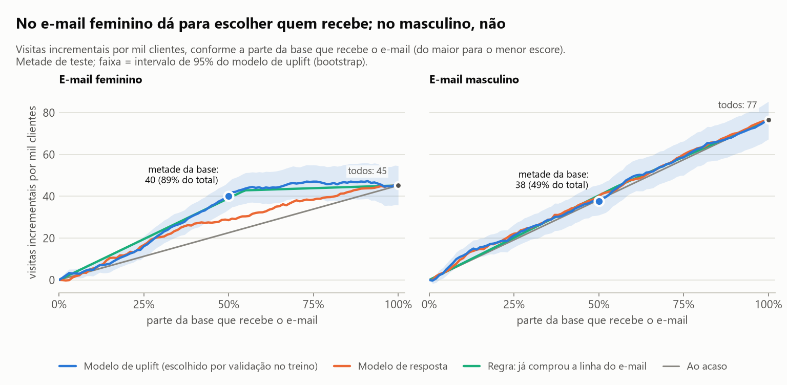
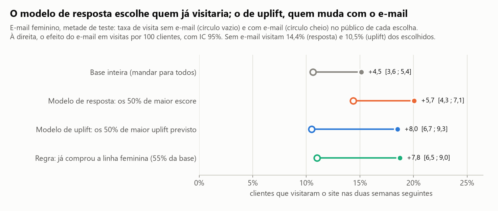
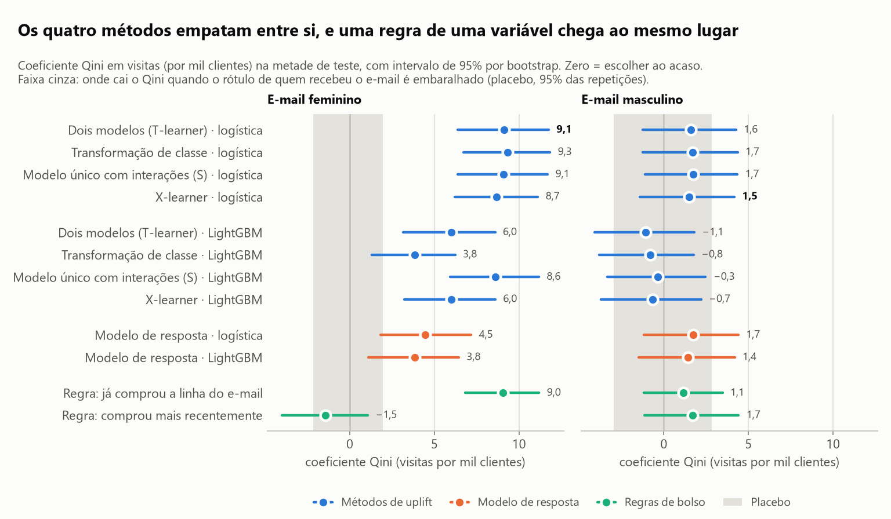
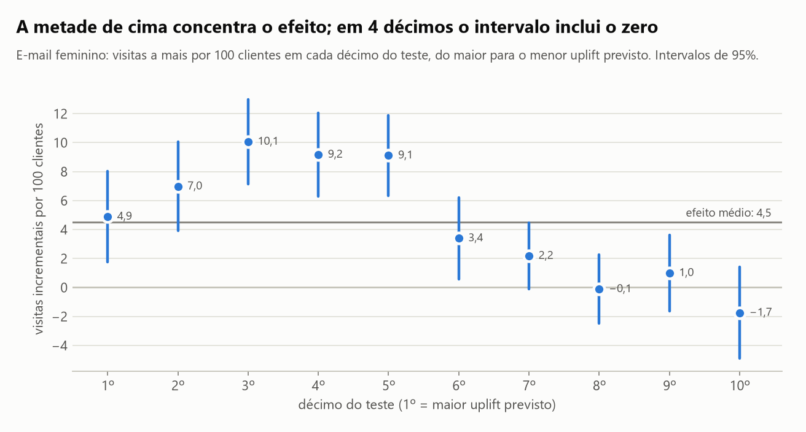
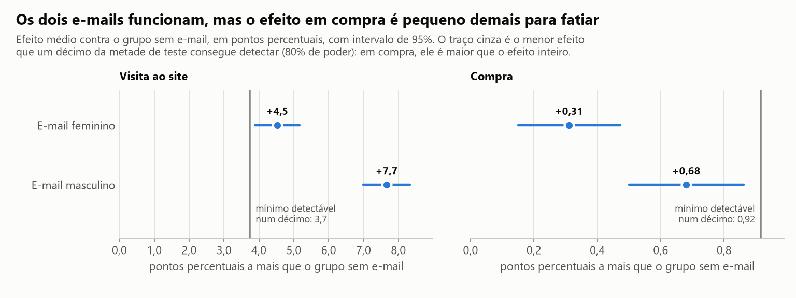
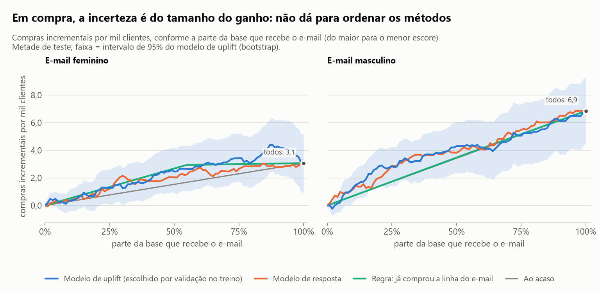

# Para quem mandar a campanha: para quem compra por causa dela ou para quem compraria de qualquer jeito?

**Depende da campanha, e onde dá para escolher, uma regra de uma variável escolhe tão bem quanto o modelo.** Num
experimento real de e-mail com 64 mil clientes, mandar o e-mail da linha feminina só para a metade da base com maior
uplift previsto preserva **89% das visitas incrementais** (IC 95%: 77% a 102%); o modelo de resposta comum, com a
mesma metade, preserva 63%. Só que a regra "quem já comprou a linha feminina" empata com o modelo de uplift, e no
e-mail da linha masculina nenhum método se distingue de sortear quem recebe.

## Em 30 segundos

- **A base é um experimento de verdade.** Kevin Hillstrom (MineThatData, 2008) sorteou 64.000 clientes entre três
  grupos: e-mail da linha masculina, e-mail da linha feminina e nenhum e-mail. Como o grupo foi sorteado, a
  diferença entre grupos é efeito do e-mail, sem modelo. A checagem do sorteio passa (maior diferença padronizada
  entre grupos: 0,014).
- **Os dois e-mails funcionam, em escalas muito diferentes.** Visita ao site: +4,5 pontos percentuais (feminino) e
  +7,7 (masculino). Compra: +0,31 e +0,68 ponto. O efeito em compra é pequeno demais para ser analisado por fatia
  da base, então o desfecho principal é a visita.
- **No e-mail feminino o modelo de uplift vence o modelo de resposta.** Coeficiente Qini de 9,1 contra 4,5 visitas
  por mil clientes; a diferença pareada é 4,6 (IC 95%: 1,9 a 7,3). O modelo de resposta escolhe quem já visitaria
  sem e-mail.
- **Mas uma regra de uma variável chega ao mesmo lugar.** "Já comprou a linha feminina" tem Qini de 9,0 (diferença
  para o modelo: 0,1; IC −1,4 a 1,6). Os quatro métodos de uplift também empatam entre si.
- **No e-mail masculino não há quem escolher.** Qini de 1,5 (IC −1,4 a 4,2): o efeito é parecido em toda a base, e
  o certo é mandar para todos.
- **O placebo zera o ganho.** Com o rótulo de quem recebeu embaralhado, o Qini cai de 9,1 para 0,0 em média (100
  repetições; a maior ficou em 3,9).

## As figuras

### 1. Dá para escolher quem recebe no e-mail feminino; no masculino, não



Cada curva responde: se o e-mail for só para os X% de maior escore, quantas visitas incrementais por mil clientes
da base ele rende? A reta cinza é sortear quem recebe. No e-mail feminino, a curva azul (modelo de uplift) sobe
rápido e achata: com metade da base ela já entrega 40,1 das 45,2 visitas incrementais de mandar para todos. Em
visitas por mil e-mails enviados, são 80,2 contra 45,2. A laranja (modelo de resposta) fica no meio do caminho, e a
verde (a regra "já comprou a linha feminina") anda junto com a azul. No masculino, as quatro linhas se confundem:
não há ordem que ajude.

### 2. O modelo de resposta escolhe quem já viria



Na metade escolhida pelo modelo de resposta, 14,4% visitam o site mesmo sem e-mail (a base inteira: 10,6%), e o
e-mail soma 5,7 pontos. Na metade escolhida pelo modelo de uplift, a taxa sem e-mail é a da base (10,5%) e o e-mail
soma 8,0 pontos. É a diferença entre prever quem responde e prever em quem a campanha faz efeito. O público do
modelo de uplift é formado inteiramente por quem já comprou a linha feminina, o que explica a regra empatar.

### 3. Os quatro métodos empatam; quem muda o resultado é o modelo de base



Com regressão logística, dois modelos (T-learner), transformação de classe, modelo único com interações
(S-learner) e X-learner ficam entre 8,7 e 9,3 no e-mail feminino, com intervalos quase idênticos. Com LightGBM,
os mesmos métodos ficam entre 3,8 e 8,6: com efeito pequeno e poucos atributos, o modelo flexível decora ruído. A
regra da recência ("quem comprou mais recentemente") fica em −1,5, pior que o acaso na estimativa pontual. A faixa
cinza mostra onde cai o Qini quando o rótulo de tratamento é embaralhado: de −2,2 a 2,0 no feminino. No painel do
masculino, todos os intervalos cruzam o zero.

### 4. O efeito está na metade de cima



Ordenando o teste pelo uplift previsto, os cinco primeiros décimos têm uplift observado entre 4,9 e 10,1 visitas
por 100 clientes; nos quatro últimos o intervalo inclui o zero. A ordem dentro da metade de cima não é limpa (o
primeiro décimo não é o melhor), o que combina com o achado: o que o modelo encontrou é, no essencial, uma variável
binária.

### 5. Em compra, o experimento não tem tamanho



O efeito médio em compra é de 0,31 ponto (feminino) e 0,68 ponto (masculino). Um décimo da metade de teste, com
cerca de mil clientes por grupo, só detecta com 80% de poder um efeito de 0,92 ponto: maior que o efeito inteiro.
Para detectar só o efeito médio do e-mail feminino em compra seriam precisos 11,7 mil clientes por grupo, e a
metade de teste tem 10,7 mil.



Em compra, o Qini do modelo de uplift no e-mail feminino é 0,76 por mil clientes (IC 0,04 a 1,51): positivo por
pouco, e a diferença para o modelo de resposta (0,37; IC −0,19 a 0,97) inclui o zero. No masculino, 0,43 (IC −0,35
a 1,26). Não dá para ordenar os métodos nesse desfecho.

## Como foi feito

1. **Checagem do sorteio.** Proporção dos três grupos (qui-quadrado contra a divisão igual: p = 0,90) e diferença
   padronizada de cada atributo entre cada e-mail e o controle (todas abaixo de 0,014).
2. **Efeito médio** de cada e-mail em visita, compra e gasto, com intervalo de 95%, e a conta de poder: o menor
   efeito que cada recorte da base consegue detectar.
3. **Separação treino/teste** meio a meio, estratificada por tratamento e desfecho. Avaliar uplift pede mais dados
   do que treinar um modelo com poucos atributos; por isso metade da base fica para o teste.
4. **Quatro métodos de uplift**, implementados em `src/uplift_campanha/uplift.py` sobre scikit-learn e LightGBM:
   dois modelos (T-learner), transformação de classe, modelo único com interações (S-learner) e X-learner, cada um
   com regressão logística e com LightGBM. Entram sete dos oito atributos anteriores ao envio (a faixa de
   histórico repete o histórico de gasto em classes). Linhas de base: o modelo de resposta (treinado só com quem
   recebeu) e duas regras de bolso.
5. **Escolha do método principal** por validação cruzada em cinco dobras dentro do treino. O teste não entra na
   escolha.
6. **Curva Qini, curva de uplift e suas áreas** implementadas em NumPy (`src/uplift_campanha/curvas.py`) e
   conferidas em dados sintéticos de efeito conhecido, incluindo o caso de efeito constante, em que a curva tem de
   seguir a diagonal mesmo com um escore que prevê bem a resposta.
7. **Incerteza por bootstrap** (mil reamostras dos clientes do teste, dentro de cada grupo), com a diferença entre
   métodos calculada reamostra a reamostra.
8. **Valor de política:** visitas incrementais por mil clientes mandando para os 10%, 20%, 30%, 50% e 70% de maior
   escore, contra o acaso e contra mandar para todos.
9. **Robustez:** teste de placebo (rótulo de tratamento embaralhado, tudo refeito, 100 vezes) e 20 separações
   treino/teste diferentes.

O notebook [`analise.ipynb`](analise.ipynb) conta a história com as tabelas.

## Comparação com a alternativa simples

Visita ao site, metade de teste. Qini em visitas por mil clientes (zero = escolher ao acaso), com IC 95%.

| Jeito de escolher quem recebe | Qini, e-mail feminino | Visitas incrementais por mil clientes, mandando para 50% (feminino) | Qini, e-mail masculino |
| --- | --- | --- | --- |
| Modelo de uplift (principal) | **9,1** (6,4 a 11,7) | **40,1** (33,5 a 46,9) | 1,5 (−1,4 a 4,2) |
| Modelo de resposta | 4,5 (1,8 a 7,2) | 28,6 (20,7 a 35,6) | 1,7 (−1,2 a 4,4) |
| Regra: já comprou a linha do e-mail | 9,0 (6,8 a 11,2) | 38,8 (32,6 a 45,5) | 1,1 (−1,2 a 3,5) |
| Regra: comprou mais recentemente | −1,5 (−4,0 a 1,1) | 16,8 (9,7 a 23,8) | 1,7 (−1,1 a 4,4) |
| Ao acaso | 0 | 22,6 | 0 |
| Mandar para todos | não se aplica | 45,2 (35,8 a 54,6), com o dobro de e-mails | não se aplica |

O veredito, com todas as letras:

- **Contra o modelo de resposta, o modelo de uplift ganha** no e-mail feminino (diferença de Qini: 4,6; IC 1,9 a
  7,3). Até 30% da base os dois escolhem igualmente bem; a diferença aparece da metade em diante.
- **Contra a regra de uma variável, empata.** A regra no seu tamanho natural (55% da base) entrega 42,6 visitas
  incrementais por mil clientes, 94% do efeito total. Para esta campanha, o modelo não paga a própria complexidade.
- **No e-mail masculino, tudo empata com o acaso.** Mandando para a metade de maior uplift previsto, o resultado é
  37,7 visitas por mil clientes; ao acaso, 38,3.
- **Os métodos sofisticados empatam entre si.** A tabela abaixo mostra os oito.

| Método | Regressão logística | LightGBM |
| --- | --- | --- |
| Dois modelos (T-learner) | 9,1 (6,4 a 11,7) | 6,0 (3,2 a 8,6) |
| Transformação de classe | 9,3 (6,7 a 11,8) | 3,8 (1,3 a 6,2) |
| Modelo único com interações (S-learner) | 9,1 (6,4 a 11,7) | 8,6 (5,9 a 11,2) |
| X-learner | 8,7 (6,2 a 11,1) | 6,0 (3,2 a 8,6) |

Qini em visita no e-mail feminino, com IC 95%. A validação cruzada no treino escolheu o T-learner com regressão
logística por uma diferença na quarta casa decimal sobre o S-learner (5,18 nos dois, com desvio de 2,9 entre
dobras); a escolha separa as famílias, não os métodos.

## Onde este estudo falha

- **O desfecho que sustenta a conclusão é visita, não compra.** A metade de teste tem entre 61 e 134 compras por
  grupo. O negócio quer compra e margem, e nesse desfecho o estudo só consegue dizer que os dois e-mails têm
  efeito médio positivo; não consegue ordenar métodos.
- **A conta de política não tem custo.** Com e-mail quase de graça, mandar para todos ainda rende mais visitas (45,2
  contra 40,1 por mil clientes no feminino). Escolher quem recebe só se paga quando o contato custa (cupom,
  ligação, SMS, mídia paga) ou cansa a base, e a base não traz descadastro nem custo para pôr isso na conta.
- **Oito atributos, um envio, 2008.** A heterogeneidade encontrada cabe numa variável binária. O empate entre os
  métodos e a vitória da regra dizem respeito a esta base; com centenas de atributos comportamentais o resultado
  pode ser outro, e este estudo não tem como mostrar.
- **A regra vencedora entrou depois da primeira rodada.** "Já comprou a linha do e-mail" não estava no plano
  inicial, que só previa a regra da recência. Incluí quando a primeira leitura mostrou que era a comparação que um
  time de CRM faria, com o teste já visto. O teste também foi olhado várias vezes durante a construção; os
  hiperparâmetros foram fixados antes e não mudaram, mas o destaque para a fração de 50% foi escolhido depois.
- **O LightGBM não foi ajustado.** Uma configuração fixa e conservadora, sem busca de hiperparâmetros. A conclusão
  "logística à frente do LightGBM" vale para essa configuração.
- **No e-mail masculino, treino e teste não contam a mesma história.** A validação cruzada no treino dava Qini
  perto de 5 para os métodos logísticos; o teste deu 1,5. E nas 20 separações diferentes o modelo de resposta
  ficou acima do acaso em todas (mediana 3,8), com os métodos de uplift quase nunca à frente dele. Há sinal de uma
  heterogeneidade pequena que um teste único deste tamanho não confirma; as 20 separações reaproveitam os mesmos
  clientes e não valem como 20 confirmações.
- **O bootstrap mede só a incerteza do teste.** Ele não reamostra o treino. As 20 separações cobrem parte disso,
  só para a família logística.
- **Dez décimos, dez intervalos, nenhuma correção para múltiplas comparações.** O último décimo tem uplift
  estimado negativo (−1,7; IC −4,9 a 1,4): não dá para afirmar que o e-mail afasta alguém.
- **Cada e-mail foi comparado com o mesmo grupo de controle, em separado.** O estudo não responde "qual dos dois
  e-mails mandar para cada cliente", que é um problema de tratamentos múltiplos.
- **Tudo aqui depende do sorteio.** A transformação de classe e a curva Qini supõem que a chance de receber é a
  mesma para todos. Em dado observacional de campanha, sem grupo de controle sorteado, nada disso se aplica direto.

## Como rodar

Pré-requisito: [`uv`](https://docs.astral.sh/uv/getting-started/installation/).

```bash
uv sync
uv run python scripts/baixar_dados.py    # confere o hash da base em data/ (ou baixa de novo da fonte)
uv run python scripts/rodar_analise.py   # regera reports/resultados.json e as figuras
uv run pytest -q -p no:cacheprovider     # 62 testes
```

A análise completa levou de 1,5 a 4,5 minutos nas medições feitas durante a construção, conforme a carga da
máquina. Sementes fixas: rodar de novo regera o mesmo `resultados.json` e as mesmas figuras, byte a byte.

**Dados.** Kevin Hillstrom, *MineThatData E-Mail Analytics and Data Mining Challenge* (2008),
[blog.minethatdata.com](https://blog.minethatdata.com/2008/03/minethatdata-e-mail-analytics-and-data.html). O autor
publicou a base para uso livre no desafio; ela não tem licença formal. O arquivo original (4 MB, 64.000 linhas,
sem dado pessoal identificável) está em `data/hillstrom_email_2008.csv`, e o script confere o SHA-256 dele. O
código deste repositório é MIT.

## Como este estudo foi feito

Este estudo foi construído com assistência de IA (Claude Code, da Anthropic), usada como par de programação.
Declaro a divisão do trabalho porque ela importa para quem avalia:

- **Meu:** a direção (quais frentes da ciência de dados estudar e por quê), o contexto de negócio que dá sentido à
  pergunta, vindo de onze anos de marketing digital (tráfego pago desde 2021, automação desde 2018), a leitura
  crítica dos resultados e a decisão do que publicar e do que declarar como limitação.
- **Com o assistente:** a formulação da pergunta a partir desse contexto, a escolha da base pública e do método, a
  implementação do código, dos testes e dos gráficos, e a redação, que revisei.
- **Como conferir:** todo número deste README sai de `reports/resultados.json`, gerado por
  `scripts/rodar_analise.py`. Os testes em `tests/` conferem as funções de método contra casos de resposta
  conhecida.

É o mesmo jeito que trabalho nos sistemas que entrego: a IA acelera a implementação, e a responsabilidade pelo que
está escrito aqui é minha.

## Summary (English)

Who should get the campaign: the customers who act because of it, or the ones who would have bought anyway? Using
Kevin Hillstrom's randomized e-mail experiment (64,000 customers; men's e-mail, women's e-mail, no e-mail), this
study implements four uplift methods on top of scikit-learn and LightGBM (T-learner, class transformation,
S-learner with interactions, X-learner) and its own NumPy Qini and uplift curves, tested on synthetic data with
known effects. On a held-out half, for the women's e-mail, targeting the top half by predicted uplift keeps 89% of
the incremental visits (95% CI 77% to 102%) versus 63% for a standard response model; the uplift model's Qini is
9.1 visits per thousand customers against 4.5 (paired difference 4.6, 95% CI 1.9 to 7.3). But a one-variable rule
("has bought women's merchandise before") ties with the model (Qini 9.0), and the four uplift methods tie with
each other. For the men's e-mail no method beats random targeting (Qini 1.5, 95% CI −1.4 to 4.2), so the right
call is to send to everyone. On purchases the average effect is 0.3 to 0.7 percentage points and the experiment
is too small to rank methods. A placebo run with shuffled treatment labels brings the gain to zero. Code, notebook
and README are in Portuguese.
